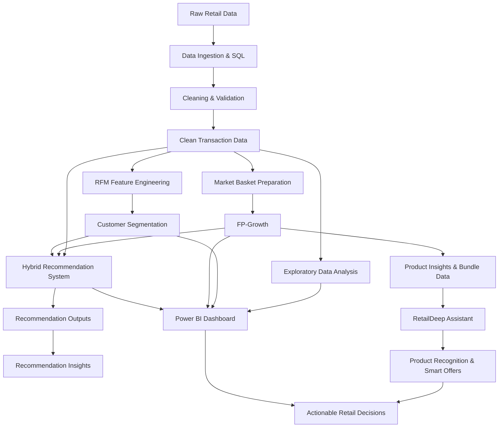

# 🛒 Retail Intelligence & Market Basket Analysis Platform

<div align="center">


**An End-to-End Data Science & AI Platform for Retail Intelligence**

Turning transaction data into customer insights, product relationships, personalized recommendations, and actionable retail decisions.


[📊 Analytics](#-project-overview) · [🧠 Machine Learning](#-machine-learning--intelligence) · [🛍️ RetailDeep](#-retaildeep-assistant) · [🏗️ Architecture](#️-system-architecture) · [🚀 Setup](#-getting-started) · [👥 Team](#-team)

</div>

---

## 📌 Project Overview

**Retail Intelligence & Market Basket Analysis Platform** is an end-to-end retail analytics and AI solution designed to transform supermarket transaction data into actionable business intelligence.

The project combines data engineering, exploratory analysis, customer segmentation, market basket analysis, recommendation systems, computer vision, and interactive business intelligence dashboards.

Rather than stopping at descriptive analytics, the platform connects analytical findings to practical retail applications.

### The platform answers four key business questions:

| Business Question | Solution |
|:---|:---|
| Who are our customers? | RFM Analysis & Customer Segmentation |
| What products are purchased together? | Market Basket Analysis & FP-Growth |
| What should we recommend to customers? | Hybrid Recommendation System |
| How can these insights be used in practice? | RetailDeep Assistant & Power BI Dashboard |

### Project Components

| Component | Purpose |
|:---|:---|
| **Core Analytics Platform** | Data preparation, EDA, KPIs, and customer intelligence |
| **Customer Segmentation** | Identifying meaningful customer groups using clustering |
| **Market Basket Analysis** | Discovering product associations and frequent itemsets |
| **Hybrid Recommender** | Generating and ranking personalized product recommendations |
| **RetailDeep Assistant** | Interactive product recognition, bundles, and smart offers |
| **Power BI Dashboard** | Communicating business insights through interactive reports |

---

## 🎯 Project Objectives

1. Build a reproducible data preparation and validation pipeline.
2. Understand retail performance through exploratory data analysis and business KPIs.
3. Segment customers using RFM features and clustering techniques.
4. Discover meaningful product associations using FP-Growth.
5. Develop and evaluate a hybrid product recommendation system.
6. Connect analytical outputs to a practical AI-powered retail application.
7. Build an interactive Power BI dashboard for business stakeholders.
8. Translate analytical findings into measurable business recommendations.

---

## 📊 Dataset Overview

**Dataset:** [Retail Data on Kaggle](https://www.kaggle.com/datasets/tawfiqakram/retail-data) by `tawfiqakram`.

The project uses supermarket-style retail transaction data covering two years of sales activity.

| Attribute | Value |
|:---|---:|
| Transaction Lines | ~814,912 |
| Customers | ~7,000 |
| Products | 133 |
| Categories | 13 |
| Stores | 25 |
| Time Period | January 2024 – December 2025 |
| Revenue After Discounts | ~75.1M |
| Profit | ~20.1M |

*Figures represent the current dataset analysis and may be refined during final validation.*

### Main Data Entities

- **Transactions:** Sales records, quantities, prices, discounts, dates, and customer/product references.
- **Customers:** Customer attributes and identifiers.
- **Products:** Product names, categories, and product attributes.
- **Stores:** Store identifiers and geographical information.

---

## 🧹 Data Engineering & Preparation

A structured data preparation workflow was developed to improve data reliability before analysis and modeling.

### Data Quality Checks

- Duplicate transaction detection.
- Missing key identification and recovery where possible.
- Invalid quantity and price validation.
- Discount validation.
- Inconsistent category and product labels.
- Mixed date-format handling.
- Referential integrity checks.
- Data issues logging and auditing.

### Data Preparation Outputs

- Cleaned transaction data.
- Validated customer and product references.
- Customer feature tables.
- Data quality audit files.
- Documented cleaning decisions.

The pipeline is designed to maintain reproducibility and traceability across analytical stages.

---

## 📈 Exploratory Data Analysis

The EDA stage focuses on understanding overall retail performance and identifying meaningful patterns.

### Business KPIs

- Total Revenue.
- Total Transactions.
- Average Order Value (AOV).
- Average Items per Basket.
- Discount Share.
- Profit and Margin.
- Monthly and Daily Sales Trends.
- Product and Category Performance.
- Store and Regional Performance.

### Key Findings

- Champions represent one of the strongest revenue-generating customer segments.
- At Risk Customers experienced a significant revenue decline between 2024 and 2025.
- Recent High Spenders showed substantial growth.
- Frequency and Monetary Value demonstrated a strong positive correlation.
- Weekday, channel, and region did not show meaningful differences between customer segments in the current analysis.

---

## 👥 Customer Segmentation

Customer segmentation identifies groups with similar purchasing behavior to support targeted marketing and retention strategies.

### RFM-Based Feature Engineering

The segmentation process uses customer-level behavioral features, including:

| Feature | Description |
|:---|:---|
| Recency | Time since the customer's last purchase |
| Frequency | Number of purchases |
| Monetary | Total customer spending |
| Average Invoice | Average transaction value |
| Visit Gap | Average time between purchases |
| Discount Share | Customer discount behavior |
| Items per Basket | Average purchased items |
| Tenure | Customer relationship duration |

### Modeling Workflow

1. Build customer-level RFM features.
2. Apply log transformation to reduce skewness.
3. Standardize numerical features.
4. Evaluate clustering configurations.
5. Apply K-Means clustering.
6. Profile and interpret resulting segments.
7. Translate segment behavior into business actions.

**Selected configuration:** K-Means with K = 8.

### Evaluation

- Silhouette Score.
- Bootstrap Stability using Adjusted Rand Index (ARI).
- Segment-level behavioral profiling.
- Business interpretability.

### Expected Business Applications

- Customer retention campaigns.
- Targeted promotions.
- VIP customer strategies.
- Re-engagement campaigns.
- Customer-specific marketing decisions.

---

## 🧠 Machine Learning & Intelligence

This section contains the analytical intelligence powering the recommendation and retail application layers.

### 1. Market Basket Analysis — FP-Growth

The Market Basket Analysis module identifies products frequently purchased together.

**FP-Growth** is used to discover frequent itemsets without generating the large candidate sets associated with traditional Apriori approaches.

#### Workflow

1. Prepare transaction baskets.
2. Transform basket data into a one-hot encoded representation.
3. Mine frequent itemsets using FP-Growth.
4. Generate association rules.
5. Calculate rule metrics.
6. Rank and filter meaningful product relationships.

#### Association Rule Metrics

| Metric | Meaning |
|:---|:---|
| Support | How frequently an itemset appears in all transactions |
| Confidence | Probability of purchasing the consequent given the antecedent |
| Lift | Strength of the association compared with independent purchasing |

#### Outputs

- Frequent itemsets.
- Association rules.
- Product relationships.
- Bundle candidates.
- Product recommendation datasets.

The resulting product insights are consumed by both the recommendation system and RetailDeep Assistant.

### 2. Hybrid Product Recommendation System

The recommendation system combines multiple recommendation strategies to generate relevant product suggestions.

#### Recommendation Components

| Component | Role |
|:---|:---|
| Popularity-Based | Provides a reliable baseline and fallback |
| Co-occurrence | Identifies products frequently purchased together |
| Item-Based Collaborative Filtering | Uses item similarity based on customer purchasing behavior |
| FP-Growth Insights | Provides association-based recommendation signals |
| LightGBM Re-ranking | Ranks candidate products using learned relevance patterns |

#### Recommendation Workflow

1. Generate candidate products from multiple sources.
2. Combine candidate recommendation signals.
3. Apply feature engineering.
4. Rank candidates using LightGBM.
5. Return Top-N recommendations.
6. Exclude products already present in the current basket.

#### Supported Scenarios

- Basket-based recommendations.
- Customer-history recommendations.
- Segment-aware recommendations.
- Cold-start fallback using popularity and available product signals.

#### Evaluation Strategy

The system uses **time-based evaluation** to simulate real-world recommendation scenarios.

- Train using historical transactions.
- Validate using a later time period.
- Test using an unseen future period.
- Prevent information leakage from future transactions.
- Compare performance against a popularity baseline.

**Evaluation Metrics:**

- Hit@K.
- Precision@K.
- Recall@K.
- NDCG@K.

Target improvements are defined against the popularity baseline and will be reported using actual evaluation results.

---

## 🛍️ RetailDeep Assistant

<details>
<summary><b>Explore the interactive AI-powered retail application</b></summary>

**RetailDeep Assistant** is the application layer of the platform. It transforms product intelligence and market basket insights into a practical shopping experience.

It connects product recognition with product relationships, smart bundles, and conditional personalized offers.

**Technology:** Streamlit · Gemini Vision · Pandas · Python

### Main Features

| Feature | Description |
|:---|:---|
| Product Selection | Search and select products manually without an API call |
| Camera Recognition | Recognize products using Gemini Vision |
| Image Upload | Identify products from uploaded images |
| Bought Together | Display frequently associated products |
| Smart Bundles | Present product bundles with regular price, offer price, and savings |
| Just-for-you Offers | Suggest one related product with a conditional discount |
| Category Insights | Show product ranking and alternative products |

### Product Recognition

The application accepts a camera image or uploaded photo and uses Gemini Vision to identify the nearest catalogue product.

The recognition workflow includes:

- Catalogue matching.
- Confidence-based decision handling.
- Bounding-box visualization.
- Fast-model-first execution with a stronger-model fallback.
- Cached recognition results.

Low-confidence or unclear recognition results are not presented as confirmed product matches.

### Smart Bundles

The application uses prepared product relationships and pricing information to generate bundle suggestions.

Bundles can include:

- Product combinations.
- Regular bundle price.
- Offer price.
- Customer savings.

Suggested discounts are based on historical discount behavior in the dataset.

### The Just-for-you Hook

When a strong bundle is unavailable, the application provides an alternative personalized offer.

1. Identify related product groups.
2. Exclude near-duplicate products.
3. Rank candidates using relatedness and popularity.
4. Display the top three alternatives.
5. Allow the shopper to select one product.
6. Apply a conditional discount when purchased with the original product.

This approach encourages larger baskets while keeping the discount configurable.

### Application Details

- Arabic RTL interface.
- Dark and light friendly cards.
- Product images with emoji fallback.
- One-hour recognition cache.
- Manual selection mode without Gemini API usage.

**Repository:** RetailDeep Assistant application files are maintained within the project repository.

</details>

---

## 🏗️ System Architecture

The platform follows a modular architecture that separates data processing, machine learning, application logic, and business intelligence.



### Architecture Layers

| Layer | Responsibility |
|:---|:---|
| Data Layer | Raw transactions, customers, products, and stores |
| Processing Layer | Cleaning, validation, and feature engineering |
| Analytics Layer | EDA, KPIs, and customer profiling |
| Intelligence Layer | Clustering, FP-Growth, and hybrid recommendations |
| Application Layer | RetailDeep Assistant |
| Visualization Layer | Power BI dashboards |
| Business Layer | Offers, bundles, and actionable recommendations |

### How the Two Repositories Work Together

The main platform produces analytical outputs, while RetailDeep consumes prepared product insights to serve an interactive user experience.

- **Main Platform:** Data engineering, customer intelligence, FP-Growth, recommendation modeling, and BI.
- **RetailDeep Assistant:** Product recognition, catalogue matching, frequently bought together, bundles, and conditional offers.

---

## 📊 Power BI Dashboard

The dashboard is designed to communicate business insights through a structured star schema.

### Data Model

- FactSales
- DimCustomer
- DimProduct
- DimStore
- Calendar

### Dashboard Pages

| Page | Focus |
|:---|:---|
| Overview | Overall retail performance |
| Customer Segments | Customer behavior and segment profiles |
| Products | Product and category performance |
| Stores & Channels | Geographical and channel analysis |
| Discounts & Demographics | Discount behavior and customer characteristics |

### Dashboard Capabilities

- Interactive date and category filters.
- Store and segment analysis.
- KPI cards and trend visualizations.
- Product performance comparisons.
- Customer segmentation insights.
- Exportable business insights.

---

## 💡 Business Recommendations

The platform is designed to support decisions such as:

| Insight | Potential Action | Business Goal |
|:---|:---|:---|
| High-value loyal customers | VIP rewards and exclusive offers | Retention |
| Declining At Risk segment | Targeted win-back campaigns | Reduce churn |
| Strong product associations | Bundle promotions | Increase basket size |
| Popular related products | Cross-selling offers | Increase revenue |
| Recent high spenders | Personalized engagement | Improve loyalty |
| Low-performing products | Review pricing and promotions | Improve performance |

---

## 📏 Evaluation & Success Criteria

The project uses measurable criteria to assess data quality, model performance, and business usability.

| Area | Evaluation |
|:---|:---|
| Data Quality | Completeness, duplicates, validation, and issues logging |
| Segmentation | Silhouette Score and bootstrap stability |
| Association Rules | Support, Confidence, Lift, and manual review |
| Recommendation | Hit@K, Precision@K, Recall@K, NDCG@K |
| Recommendation Baseline | Comparison against popularity-based recommendations |
| Dashboard | Rendering performance and stakeholder usability |
| Application | Recognition handling and recommendation workflow |

Performance targets are treated as evaluation goals, not achieved results, until supported by measured outputs.

---

## 🧰 Technology Stack

### Data Science & Analytics

- Python
- Pandas
- NumPy
- Scikit-learn
- Matplotlib
- Jupyter Notebook

### Machine Learning

- K-Means Clustering
- RFM Analysis
- FP-Growth
- Association Rules
- Collaborative Filtering
- Cosine Similarity
- LightGBM

### AI Application

- Streamlit
- Google Gemini Vision API
- Pillow
- Pydantic

### Data & Storage

- SQL
- SQLite / PostgreSQL
- CSV
- Parquet

### Business Intelligence

- Power BI
- DAX
- Power Query
- Star Schema

### Development & Collaboration

- Git
- GitHub
- Jupyter
- VS Code

---

## 📁 Project Structure

```text
.
├── README.md
│
├── data/
│   ├── raw/
│   ├── processed/
│   └── features/
│
├── docs/
│   ├── EDA_Report.pdf
│   ├── ML_Handoff.pdf
│   └── ...
│
├── notebooks/
│   ├── EDA.ipynb
│   ├── Final.ipynb
│   └── EDA_After_ML.ipynb
│
├── sql/
│
├── src/
│   ├── data/
│   ├── features/
│   ├── segmentation/
│   ├── market_basket/
│   ├── recommender/
│   └── evaluation/
│
├── RetailDeep/
│   ├── app.py
│   ├── matcher.py
│   ├── recommend.py
│   ├── related.py
│   ├── build_catalog.py
│   ├── build_bundles.py
│   ├── products_catalog.csv
│   ├── product_bundles.csv
│   ├── product_recommendations.csv
│   ├── product_offers.csv
│   ├── images/
│   └── requirements.txt
│
├── dashboard/
│   └── PowerBI_README.md
│
├── tests/
│
└── requirements.txt
```

*Illustrative structure: directory names should be aligned with the actual repository layout.*

---

## 🚀 Getting Started

### 1. Clone the repository

```bash
git clone https://github.com/SherifAzb/End-to-End-Business-Analytics-Decision-Platform.git

cd End-to-End-Business-Analytics-Decision-Platform
```

### 2. Create a virtual environment

```bash
python -m venv .venv
```

**Windows:**

```powershell
.venv\Scripts\activate
```

**Linux / macOS:**

```bash
source .venv/bin/activate
```

### 3. Install dependencies

```bash
pip install -r requirements.txt
```

### 4. Explore the analytical notebooks

Start with the EDA notebook, then explore the customer segmentation and post-ML analysis notebooks.

### 5. Run RetailDeep Assistant

Navigate to the actual RetailDeep application directory, install its dependencies, configure the Gemini API key, and launch:

```bash
streamlit run app.py
```

The manual product-selection mode does not require Gemini. Camera and image-upload recognition require a configured Gemini API key.

**Security:** Never commit API keys or secret files to GitHub.

---

## 📍 Current Project Progress

| Module | Status |
|:---|:---:|
| Data Audit & Cleaning | ✅ Done |
| Exploratory Data Analysis | ✅ Done |
| RFM Feature Engineering | ✅ Done |
| Customer Segmentation (K-Means, K=8) | ✅ Done |
| Post-ML Segment Profiling | ✅ Done |
| Market Basket EDA | ✅ Done |
| Full FP-Growth Module | ✅ Done |
| Hybrid Recommender | ✅ Done |
| Time-Based Recommendation Evaluation | ✅ Done |
| RetailDeep Assistant Prototype | ✅ Prototype |
| Power BI Dashboard | 🔄 In Progress |
| Final Integration & QA | ⏳ Pending |
| Final Report & Presentation | ⏳ Pending |

---

## 🗓️ Project Methodology

The project follows the **CRISP-DM** methodology:

1. Business Understanding.
2. Data Understanding.
3. Data Preparation.
4. Modeling.
5. Evaluation.
6. Deployment and Business Communication.

The team uses modular development, Git branches, peer review, documented handoffs, and regular progress reviews.

---

## 🔐 Data Privacy & Responsible AI

- Customer identifiers are treated as analytical identifiers.
- Personal information is not intended for public exposure.
- API keys and credentials must remain outside version control.
- Product recognition uses catalogue matching and confidence-based handling.
- Unclear recognition results should not be presented as confirmed matches.
- Third-party AI services may process uploaded images according to their provider policies.

---

## 🔗 Project Resources

| Resource | Link |
|:---|:---|
| Main Repository | [End-to-End Business Analytics Decision Platform](https://github.com/SherifAzb/End-to-End-Business-Analytics-Decision-Platform) |
| Dataset | [Retail Data – Kaggle](https://www.kaggle.com/datasets/tawfiqakram/retail-data) |
| Program | DEPI – Digital Egypt Pioneers Initiative |
| Supervisor | Sara Ashraf |

---

## 👥 Team

<div align="center">

### 🏛️ BFCAI Team · DEPI Data Scientist Track

| # | Team Member |
|:---:|:---|
| 1 | **شريف أيمن السيد عزب** |
| 2 | **سما داود محمد المشوخي** |
| 3 | **علي محمد حسن محمد** |
| 4 | **منة مجدي حسن احمد** |
| 5 | **روان باسم محمد عبدالستار** |

</div>

---

<div align="center">

**Built with 💚 by the BFCAI Team for the DEPI Internship**

*Turning Retail Data into Intelligent Decisions.*


</div>
