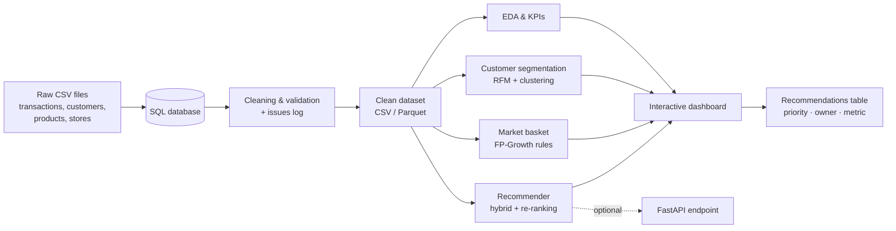

# 🛒 Retail Intelligence & Market Basket Analysis Platform

> An end-to-end business analytics decision platform for a supermarket-style retailer: reproducible data pipeline, customer segmentation, market basket analysis, a hybrid product recommender, and an interactive dashboard that ends in a table of actionable recommendations.


**Program:** DEPI | Digital Egypt Pioneers Initiative
**Project type:** Capstone, End-to-End Business Analytics Decision Platform
**Supervisor:** Sara Ashraf
**Version:** 1.0 (16 October 2026)

---

## 📑 Table of Contents

- [Overview](#-overview)
- [Problem Statement](#-problem-statement)
- [Objectives](#-objectives)
- [Architecture](#-architecture)
- [Modules](#-modules)
- [Data](#-data)
- [Evaluation & KPIs](#-evaluation--kpis)
- [Requirements Summary](#-requirements-summary)
- [Tech Stack](#-tech-stack)
- [Repository Structure](#-repository-structure)
- [Getting Started](#-getting-started)
- [Project Plan & Milestones](#-project-plan--milestones)
- [Team](#-team)
- [Engineering Workflow](#-engineering-workflow)
- [Risks](#-key-risks)
- [Documentation](#-documentation)
- [Privacy & License](#-privacy--license)

---

## 📌 Overview

The platform turns raw sales transactions into three connected insights and delivers them through one interactive dashboard and one recommendations table:

| Insight | Type | Answers |
|---|---|---|
| **Customer segmentation** | Unsupervised learning | Who are the best customers? Who stopped buying? Does behavior differ between segments? |
| **Market basket analysis** | Association rule mining | Which products are bought together? Which bundles are possible? |
| **Recommender system** | Hybrid recommender | What should we suggest for this basket or this customer? |

All three modules read the **same cleaned dataset**, and every cleaning decision is logged with before/after counts so every number can be traced back to the source.

## ❓ Problem Statement

The retailer owns thousands of purchase records but cannot answer four practical questions:

1. What do customers buy **together**?
2. Who are the most **valuable** customers?
3. Which products should be **recommended** to each customer?
4. How can the **average order value** be increased?

Decisions about shelf layout, bundles and campaigns are therefore taken without evidence. This project closes that gap.

## 🎯 Objectives

| ID | Objective | Target |
|----|-----------|--------|
| O1 | Documented, reproducible data pipeline (SQL schema, cleaning, validation) with an issues log | 6 Nov 2026 |
| O2 | Customer clustering evaluated with Silhouette and bootstrap stability, every segment profiled in business language | 16 Nov 2026 |
| O3 | FP-Growth association rules with support, confidence and lift for every rule | 16 Nov 2026 |
| O4 | Recommender compared with a popularity baseline on a time-based hold-out | 25 Nov 2026 |
| O5 | Interactive dashboard answering all four groups of stakeholder questions | 27 Nov 2026 |
| O6 | Recommendations table (priority, owner, metric), final report, presentation and infographic | 4 Dec 2026 |

## 🏗️ Architecture



## 🧩 Modules

### 1. Data ingestion & cleaning
- Loads raw CSVs into SQL tables **without changing raw values** (all fields read as text first).
- Detects and handles duplicates, missing keys, invalid quantities, price outliers, invalid discounts, inconsistent labels and mixed date formats.
- Recovers missing values from the same transaction or reference tables where possible; drops records only when recovery is impossible.
- Validates foreign keys (customer, product, store) and reports orphan records.
- Writes an **issues log**: issue, rows affected, decision, reason.

### 2. EDA & business KPIs
Revenue, number of transactions, average order value, items per basket, discount share and margin, with trends by month, weekday, store, region and category, plus rankings of products and categories by revenue and quantity.

### 3. Customer segmentation
- **Behavior features:** recency, frequency, monetary value, average order value, visit gap, discount share, items per basket, tenure.
- Goes beyond classic RFM so discount-driven customers can be separated from others.
- Clustering with at least two configurations, evaluated with **Silhouette** and **bootstrap stability (Adjusted Rand Index ≥ 0.80)**.
- Every segment gets a **name, profile and recommended action**; customer lists are exportable (for example the lapsed segment for win-back campaigns).

### 4. Market basket analysis
- **FP-Growth** with configurable minimum support, confidence and lift (preferred over Apriori for speed on large transaction tables).
- Each rule is shown with support, confidence, lift and a **plain-language reading**.
- Rules are ranked by **lift**, not only confidence, to avoid rules that look strong only because a product is popular.
- Bundle candidates are derived from the strongest rules.

### 5. Recommender system
- **Hybrid model:** popularity and co-occurrence baselines, item-based collaborative filtering (cosine similarity), then a **LightGBM re-ranker**.
- Top-N products for a basket, **excluding products already in the basket**, each with a short reason.
- Optional recommendations for a specific customer id using history and segment.
- Cold-start fallback: empty basket uses customer history, segment and popularity.
- Optional documented **API endpoint** (FastAPI).

### 6. Dashboard & recommendations table
Pages for KPIs, products, segments, rules and recommendations, with date, store, category and segment filters and CSV export. The final recommendations table lists **at least five actions**, each with an owner team, a priority and a metric to monitor.

## 🗂️ Data

| Item | Value |
|---|---|
| Dataset | Retail_Data |
| Publisher | tawfiqakram (Kaggle) |
| Source | https://www.kaggle.com/datasets/tawfiqakram/retail-data |
| Date accessed | 16 October 2026 |
| Licence | **To be confirmed** (not stated on the dataset page) |
| Working size | About 0.8 million transaction lines, 25 stores, 7,000 customers |

The dataset contains realistic quality problems (missing values, duplicates, inconsistent formats, outliers) that the pipeline must handle.

**Tables**

| Table | Main fields |
|---|---|
| `transactions` | line id, transaction (invoice) id, customer id, date, product id, product name, category, quantity, unit price, discount, store, payment method, channel |
| `customers` | customer id, city, age group, gender, birth year, join date, loyalty member, preferred payment |
| `products` | product id, name, category, brand, unit, cost price, list price, perishable flag |
| `stores` | store id, name, city, area, region, size class, opening date |

## 📊 Evaluation & KPIs

Evaluation is **time-based**: train on the past, test on a later period, with features built only from the past to prevent data leakage.

| Area | KPI | Target |
|---|---|---|
| Data quality | Key completeness after cleaning | ≥ 99% |
| Data quality | Exact duplicate rows after cleaning | 0 |
| Data quality | Issues-log coverage | 100% |
| Segmentation | Stability (ARI on bootstrap samples) | ≥ 0.80 |
| Segmentation | Segments with name, profile and action | 100% |
| Rules | Rules with lift ≥ 2 reviewed manually | ≥ 10 |
| Recommender | Hit@10 vs popularity baseline | ≥ 1.25× |
| Recommender | Hit@1 vs popularity baseline | ≥ 2× |
| Performance | Dashboard page render time | ≤ 5 s |
| Performance | One basket recommendation (local) | ≤ 1 s |
| Delivery | Business questions answered by the dashboard | 100% |
| Delivery | Test pass rate | ≥ 90% |
| Delivery | Actionable recommendations (priority, owner, metric) | ≥ 5 |
| Delivery | Milestones delivered on time | 4 of 4 |

## ✅ Requirements Summary

| Category | Count | Highlights |
|---|---|---|
| User stories | 15 | 11 Must, 2 Should, 2 Could |
| Functional requirements | 26 | 17 Must, 8 Should, 1 Could, across 7 modules |
| Non-functional requirements | 17 | Performance, scalability, security & privacy, reliability, portability, explainability |

Key non-functional targets:

- **Performance:** full pipeline in under 15 minutes on an 8 GB RAM laptop.
- **Scalability:** handles at least 1 million transaction lines (chunks or efficient formats).
- **Reproducibility:** same input and seed produce the same outputs.
- **Security & privacy:** anonymised identifiers only; no credentials committed; inputs validated.
- **Portability:** Windows and Linux, Python 3.10+, `requirements.txt`.
- **Explainability:** every segment, rule and recommendation is explainable in business terms.

Out of scope: real-time point-of-sale integration, live A/B experiments, price optimisation, demand forecasting, mobile app and personal identifying information.

## 🧰 Tech Stack

| Layer | Tools |
|---|---|
| Language & analysis | Python, pandas, NumPy, scikit-learn, matplotlib, Jupyter |
| Mining & ML | mlxtend (FP-Growth), LightGBM |
| Data | SQL database (SQLite or PostgreSQL, to be confirmed in design), CSV, Parquet |
| Dashboard | Interactive dashboard tool, to be confirmed with the supervisor |
| Collaboration | Git & GitHub (branches, pull requests, issues) |
| Optional | MLflow, FastAPI, Docker, GitHub Actions |

## 📁 Repository Structure

```
.
├── README.md
├── docs/                          # Project documentation
│   └── DEPI_Planning_Documents_Retail_Intelligence_Platform.pdf
├── data/                          # Raw and cleaned data + data dictionary (to be added)
├── sql/                           # Schema, loading and KPI check queries (to be added)
├── notebooks/                     # Cleaning, EDA, segmentation, rules, recommender (to be added)
├── src/                           # Pipeline source code (to be added)
├── dashboard/                     # Dashboard files (to be added)
├── tests/                         # Test cases (to be added)
└── requirements.txt               # (to be added)
```

## 🚀 Getting Started

> ⚠️ The project is in the documentation phase. Implementation starts after the design milestone, and this section will be finalized then. The steps below describe the intended workflow.

**Prerequisites**

- Python 3.10 or later
- Git
- 8 GB RAM is enough for the working dataset

**Installation**

```bash
git clone https://github.com/SherifAzb/End-to-End-Business-Analytics-Decision-Platform.git
cd End-to-End-Business-Analytics-Decision-Platform
python -m venv .venv
source .venv/bin/activate        # Windows: .venv\Scripts\activate
pip install -r requirements.txt  # file will be added during implementation
```

**Data**

Download the dataset from [Kaggle](https://www.kaggle.com/datasets/tawfiqakram/retail-data) and place the CSV files in `data/raw/`.

**Run**

The pipeline will run end-to-end from documented commands with fixed random seeds (cleaning → segmentation → rules → recommender), writing the clean dataset, the issues log and the result tables used by the dashboard. Exact commands will be added after implementation.

## 🗓️ Project Plan & Milestones

| Phase | Activities | Start | End |
|---|---|---|---|
| A. Planning documents | Planning, literature review, requirements | 8 Oct | 16 Oct |
| B. System analysis & design | Use cases, ERD, DFD, UML, architecture, wireframes | 17 Oct | 6 Nov |
| C1. Data pipeline | SQL schema, loading, cleaning, validation, issues log | 19 Oct | 6 Nov |
| C2. EDA & KPIs | Descriptive analysis, trends, business KPIs | 26 Oct | 13 Nov |
| C3. Segmentation & market basket | Clustering, profiling, FP-Growth rules | 2 Nov | 16 Nov |
| C4. Recommender | Baselines, hybrid model, time-based evaluation | 9 Nov | 25 Nov |
| C5. Dashboard | KPIs, segments, rules, recommendations pages | 9 Nov | 27 Nov |
| C6. Integration & freeze | README, repo clean-up, final source code | 23 Nov | 30 Nov |
| D1. Testing & QA | Test plan, test cases, automated tests, bug reports | 9 Nov | 1 Dec |
| D2. Final delivery | Final report, presentation, infographic, user manual | 23 Nov | 4 Dec |
| E. Optional deployment | API, containers, CI/CD, hosting | 16 Nov | 27 Nov |

| Milestone | Date | Exit criteria |
|---|---|---|
| **M1** Planning documents | 16 Oct 2026 | Planning, literature review and requirements on GitHub |
| **M2** Design & data pipeline | 6 Nov 2026 | Design diagrams complete; cleaned dataset from one script; issues log complete |
| **M3** Implementation complete | 30 Nov 2026 | Models evaluated; dashboard working; README lets another person run everything; source frozen |
| **M4** Final delivery | 4 Dec 2026 | Test report, user manual, technical documentation, presentation, infographic |

## 👥 Team

**Team Leader:** شريف أيمن السيد عزب

| Team members |
|---|
| شريف أيمن السيد عزب (Team Leader) |
| سما داود محمد المشوخي |
| علي محمد حسن محمد |
| منة مجدي حسن احمد |
| روان باسم محمد عبدالستار |

**Roles**

| Member | Role | Main responsibilities |
|---|---|---|
| member1 | R1: Lead + Communication | Business case, KPIs, coordination, task board, reports, recommendations table, presentation |
| member2 | R2: Data Engineer | SQL database, loading scripts, KPI queries, clean data layer, reproducibility |
| member3 | R3: Cleaning + EDA | Data profiling, cleaning rules, issues log, EDA notebook |
| member4 | R4: ML + Evaluation | Behavioral features, clustering, association rules, recommender, evaluation |
| member5 | R5: Dashboard + Deployment | Dashboard design and build, number checks against SQL, optional API and deployment |

## 🔀 Engineering Workflow

- **Methodology:** CRISP-DM in short weekly iterations, with a 45-minute weekly meeting (done, blockers, next week, milestone check).
- **Git:** protected `main` branch; feature branches named `feat/rN-topic`; small pull requests, each reviewed by a second person (100% review coverage target).
- **Data contract:** table and column names are agreed once and changed only with the whole team's approval.
- **Documentation:** every decision (what was dropped, filled or capped, and why) is written in the issues log.
- **Cross-training:** every member must be able to explain the whole project.

## ⚠️ Key Risks

| Risk | Score | Mitigation |
|---|---|---|
| Data cleaning takes longer than planned and blocks modelling | 9 | Start profiling in week 1; model on a sample until clean data is ready |
| Dataset source or licence not documented correctly | 6 | Record source, link, licence and access date in README and proposal |
| Data leakage inflates model results | 6 | Time-based split; features from the past only; peer review of every feature |
| Limited tool experience in the team | 6 | Learning plan per role; pair programming; backup roles |
| Scope creep | 6 | Frozen scope; optional items start only after M3 criteria are met |
| Dashboard numbers differ from SQL results | 6 | Single KPI definition document; numbers checked against SQL |
| Deadline pressure before M2, M3, M4 | 6 | Finish one week before each DEPI date; prioritize must-have requirements |

Scores are probability × impact (1 to 3 each); risks scoring 6 or more are reviewed at every weekly meeting. The full register has 12 risks.

## 📚 Documentation

| Deliverable | File | Due | Status |
|---|---|---|---|
| Project Planning & Management, Literature Review, Requirements Gathering | [docs/DEPI_Planning_Documents_Retail_Intelligence_Platform.pdf](docs/DEPI_Planning_Documents_Retail_Intelligence_Platform.pdf) | 16 Oct 2026 | ✅ Submitted |
| System Analysis & Design | _coming soon_ | 6 Nov 2026 | ⏳ |
| Implementation | _coming soon_ | 30 Nov 2026 | ⏳ |
| Testing, Final Presentation & Reports | _coming soon_ | 4 Dec 2026 | ⏳ |

The planning PDF contains: the project proposal and plan (Gantt, RACI, risks, KPIs), a literature review of similar solutions (Apriori, FP-Growth, RFM, Instacart, Online Retail II, collaborative filtering, learning to rank, Amazon Personalize), and the full requirements set (stakeholders, user stories, use cases, functional and non-functional requirements, traceability matrix).

## 🔒 Privacy & License

- Only **anonymised identifiers** are stored in this repository. No names, phone numbers or addresses, and no credentials, keys or tokens (configuration uses environment variables). A review checklist is completed before every push.
- This project was developed for educational purposes as part of the DEPI program.
- The dataset is subject to the licence of its publisher on Kaggle (to be confirmed and recorded here).
