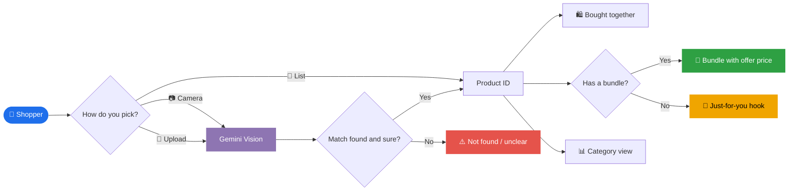

 <div align="center">


<a href="https://github.com/SherifAzb/End-to-End-Business-Analytics-Decision-Platform">

</a>

<br/>


**Pick a product. See what people buy with it. Get a bundle or a personal deal.**

[✨ Features](#-features) · [🧠 How it works](#-how-it-works) · [🎯 The hook](#-the-just-for-you-hook) · [🚀 Run it](#-run-it-locally) · [🗂️ Files](#️-project-files) · [👥 Team](#-team)

</div>

---

## 📌 About

**RetailDeep Assistant** is the interactive "deep" module of our DEPI capstone **Retail Intelligence & Market Basket Analysis Platform**.

It takes the results of market basket analysis and puts them in front of a shopper or store employee in one simple screen.

Choose a product (from a list, with the camera, or with a photo) and the app shows, on **one result page**:

| Feature | Description |
|:---|:---|
| 🛍️ **Bought together** | Products that usually land in the same basket |
| 🎁 **Bundles** | Ready bundles with regular price, offer price, and savings |
| 🎯 **Just-for-you deal** | When there is no bundle, pick one related product and get it at a discount |
| 📊 **Category view** | The product's rank in its category and three alternatives |

> The main platform (data pipeline, segmentation, association rules, recommender, dashboard) lives in the [End-to-End Business Analytics Decision Platform](https://github.com/SherifAzb/End-to-End-Business-Analytics-Decision-Platform) repository.
>
> This repository is the application that serves its product insights.

---

## ✨ Features

<table>
<tr>
<td width="33%" valign="top">

### 🛒 Pick from the list

Category filter plus a searchable product list.

**No API call and no quota.**

</td>
<td width="33%" valign="top">

### 📷 Camera

Take a photo of the product. Gemini finds the **nearest catalogue product** and draws a box around it.

</td>
<td width="33%" valign="top">

### 📁 Upload a photo

Same smart matching, from any image on your device (`jpg`, `jpeg`, `png`, `webp`).

</td>
</tr>
<tr>
<td valign="top">

### 🛍️ Frequently bought together

Suggestions with a confidence bar. Only partners that appear in **20% or more** of the product's invoices are shown.

</td>
<td valign="top">

### 🎁 Smart bundles

Pairs and triples with regular price, offer price, and savings. The discount is based on the discount that was **actually given** in the data.

</td>
<td valign="top">

### 🎯 "Just for you" hook

For products without a bundle: choose **one** related product and get it at a lower price when bought together.

</td>
</tr>
</table>

**Also included:**

- 🌐 Arabic RTL interface.
- 🌙 Dark and light friendly cards.
- 🖼️ Product images with emoji fallback.
- ⚡ Cached recognition (1 hour).

---

## 🧠 How it works



**Matching:** The model returns the nearest catalogue product, whether it is an exact or similar match, a confidence score, and a bounding box.

The app tries the fast model first and falls back to the stronger one. Low-confidence results are never shown as a match.

---

## 🎯 The "Just for you" hook

Most products have no strong bundle. Instead of showing an empty section, the app now makes a **personal offer**:

1. 🔗 It looks at **related products** (breakfast items, sandwich items, cooking items, baby care, cleaning, personal care, and more, defined in `related.py`).
2. 🚫 It removes near-duplicates, so *Milk 500ml* never offers *Milk 1L*.
3. 🏆 It ranks the rest by relatedness and popularity and keeps the **top 3**.
4. 🎯 The shopper picks **one**, and gets it at a discount **only when bought with the original product**.

### Example

> Looking at **Croissant** → choose *Butter 200g*, *Jam 340g*, or *Baladi Bread Pack* → the chosen item is **10% cheaper** with the croissant.

### Why the store wins too

| Benefit | Explanation |
|:---|:---|
| 📈 Bigger basket | The deal needs a second product in the same order |
| 💸 Controlled discount | 10%, lower than the ~17% average discount already given in the data |
| 🔥 Better acceptance | Popular related items are ranked first |

Change the discount in one line:

```python
HOOK_DISCOUNT = 0.10
```

Located in `recommend.py`.

---

## 🚀 Run it locally

### 1. Clone the repository

```bash
git clone https://github.com/SherifAzb/End-to-End-Business-Analytics-Decision-Platform.git

cd End-to-End-Business-Analytics-Decision-Platform
```

### 2. Create a virtual environment

```bash
python -m venv .venv
```

Activate it:

**Windows:**
```bash
.venv\Scripts\activate
```

**Linux / macOS:**
```bash
source .venv/bin/activate
```

### 3. Install dependencies

```bash
pip install -r requirements.txt
```

### 4. Configure your Gemini API key

Add your Gemini key using **one** of these methods:

| Method | How |
|:---|:---|
| 📄 File | Create `gemini_key.txt` next to `app.py` and paste the key |
| 🌍 Environment | Set `GEMINI_API_KEY` as an environment variable |
| ☁️ Streamlit Cloud | Add `GEMINI_API_KEY` in **Secrets** |

For Windows PowerShell:

```powershell
$env:GEMINI_API_KEY="your-key"
```

For Linux / macOS:

```bash
export GEMINI_API_KEY="your-key"
```

### 5. Launch the application

```bash
streamlit run app.py
```

> ⚠️ **Never commit `gemini_key.txt` or expose your API key.** It is already in `.gitignore`.
>
> The list mode works without any API key. Only camera and upload modes require Gemini.

<details>
<summary><b>🔧 Rebuild the data files (optional)</b></summary>

`build_catalog.py` and `build_bundles.py` read the full transactions file `data.csv` and only need to run again when the data changes.

```bash
pip install numpy scipy

python build_catalog.py

python build_bundles.py data.csv
```

**Bundle rules used by `build_bundles.py`:**

| Rule | Value |
|:---|:---|
| Minimum partner confidence | `0.20` |
| Minimum share of the product's invoices | `10%` |
| Minimum number of invoices | `200` |
| Suggested discount | Real average discount, rounded to 5% |

</details>

---

## 🗂️ Project files

```text
.
├── app.py                        # Streamlit UI: 3 pick modes, RTL, cards
├── matcher.py                    # Gemini call + nearest-product decision
├── recommend.py                  # Suggestions, bundles, hook, category view
├── related.py                    # Related-product groups used by the hook
├── build_catalog.py              # Builds products_catalog.csv
├── build_bundles.py              # Builds product_bundles.csv
├── products_catalog.csv          # Product, category, brand, latest price
├── product_bundles.csv           # Bundles with regular and offer price
├── product_recommendations.csv   # Bought-together results from basket EDA
├── product_offers.csv            # Discount behaviour and sales volume
├── images/                       # Product photos named by Product_ID
└── requirements.txt
```

<details>
<summary><b>📝 Notes</b></summary>

- *Spaghetti 500g* is treated as *Pasta 400g*: it is hidden from the list and the camera maps to *Pasta 400g*.
- Product images are read from `images/<Product_ID>.<ext>` first, then from an optional `Image_URL` column.
- The category rank uses the number of sales lines per product.

</details>

---

## 🧰 Tech stack

<div align="center">


</div>

---

## 🔗 The full project

| | |
|:---|:---|
| 🏗️ Main repository | [End-to-End Business Analytics Decision Platform](https://github.com/SherifAzb/End-to-End-Business-Analytics-Decision-Platform) |
| 📦 Dataset | [Retail Data on Kaggle](https://www.kaggle.com/datasets/tawfiqakram/retail-data) by `tawfiqakram` |
| 🎓 Program | DEPI – Digital Egypt Pioneers Initiative |
| 👩‍🏫 Supervisor | Sara Ashraf |

---

## 👥 Team

<div align="center">

### 🏛️ BFCAI Team · DEPI Internship

| # | Name |
|:---:|:---|
| 1 | **شريف أيمن السيد عزب** |
| 2 | **سما داود محمد المشوخي** |
| 3 | **علي محمد حسن محمد** |
| 4 | **منة مجدي حسن احمد** |
| 5 | **روان باسم محمد عبدالستار** |

</div>

---

<div align="center">

**Made with 💚 by the BFCAI Team for the DEPI Internship**

*If this project helped you, give it a ⭐*


</div>
